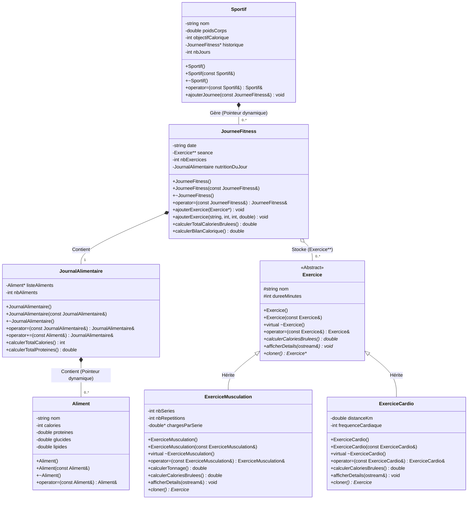
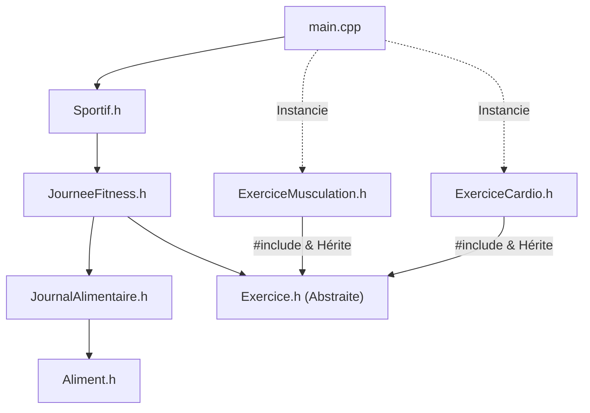

# 📐 Architecture Détaillée et Graphe de Dépendances

Ce document détaille la conception orientée objet de **Fit_tracker** et justifie les choix techniques liés à la gestion de la mémoire et au polymorphisme.

## 1. Diagramme de Classes UML



## 2. Gestion de la Copie Profonde (Deep Copy) et Polymorphisme

Étant donné que chaque classe doit posséder un constructeur par copie et surcharger l'opérateur d'affectation `=` :
* **Tableaux dynamiques simples (`double*`, `Aliment*`, `JourneeFitness*`)** : Lors de la copie ou de l'affectation, l'ancienne mémoire est désallouée (`delete[]`), un nouveau bloc mémoire est alloué (`new[]`), et chaque élément est copié individuellement.
* **Tableau dynamique polymorphe (`Exercice** seance`)** : Pour copier une `JourneeFitness` sans connaître à l'avance le type exact de chaque `Exercice` pointé (`ExerciceMusculation` ou `ExerciceCardio`), la classe abstraite `Exercice` définit la méthode virtuelle pure `virtual Exercice* cloner() const = 0;` (Patron de conception *Prototype*).

## 3. Arbre d'inclusion des fichiers d'en-tête (`#include`)

Pour éviter toute inclusion circulaire lors de la compilation séparée, le projet suit une hiérarchie stricte du bas vers le haut (des classes de base indépendantes vers le contrôleur principal) :

```text
                       [ main.cpp ]
                            │
                            ▼
                      [ Sportif.h ]
                            │
                            ▼
                   [ JourneeFitness.h ]
                     /              \
                    /                \
                   ▼                  ▼
     [ JournalAlimentaire.h ]    [ Exercice.h ] (Classe abstraite)
               │                       ▲
               ▼                      / \
         [ Aliment.h ]               /   \
                                    /     \
        [ ExerciceMusculation.h ] ─┘       └─ [ ExerciceCardio.h ]
```

### Équivalent visuel (Graphe de compilation)



### Ordre logique de développement et de compilation :
1. **Niveau 0 (Classes feuilles sans dépendances internes)** : `Aliment.h` et `Exercice.h`.
2. **Niveau 1 (Classes spécialisées et conteneurs premiers)** : `JournalAlimentaire.h` (dépend de `Aliment.h`), ainsi que `ExerciceMusculation.h` et `ExerciceCardio.h` (héritent de `Exercice.h`).
3. **Niveau 2 (Agrégation journalière)** : `JourneeFitness.h` (combine `JournalAlimentaire.h` et le tableau polymorphe `Exercice**`).
4. **Niveau 3 (Contrôleur global)** : `Sportif.h` (gère l'historique dynamique des `JourneeFitness`).
5. **Niveau 4 (Point d'entrée)** : `main.cpp` (orchestre le menu console et les tests unitaires).